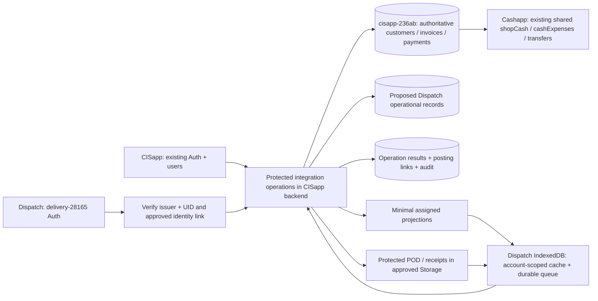

# Stage B: proposed integration architecture and contracts

Status: development design following AUDIT.md. Proposed collections/endpoints below are **new contracts**, not claims that they already exist. No production deployment or financial service replacement is authorised by this document.

## Architecture

Preserve both existing financial applications and their existing accounts. Keep `delivery-28165` as the separate Dispatch identity/evidence project unless an explicit project-ownership decision changes it. Use `cisapp-236ab` for authoritative financial mutations because CISapp and Cashapp already share that database. Hosting domains do not determine ledger ownership.

Financial receipt documents, customer advance/outstanding updates, shop-funds increments and a financial operation-result record can ultimately commit in one **CISapp-database** transaction. Dispatch-project projection/outbox updates and evidence uploads cannot be part of that same transaction. Use durable cross-project events with explicit delivery acknowledgements and recovery states; never claim a cross-project atomic commit.

## Proposed physical project placement

- delivery-28165: Dispatch operational jobs/trips/attempts/submissions/custody, driver-facing projections, evidence objects and device synchronisation metadata.
- cisapp-236ab: existing customers/invoices/payments/cash collections, the financial posting guard/results/links and canonical federation approvals against existing CISapp employees.
- Server-provisioned membership projections in delivery-28165 can support restricted driver reads. Clients cannot create their own membership or operational role.
- Existing CISapp staff can call the protected bridge using their existing CISapp token; do not assume it can directly authorise Firestore reads in a different project. Staff do not need to share passwords or acquire a Driver/Staff workaround role. Any later token-exchange design must be explicitly reviewed and tested.
- A backend service identity needs reviewed least-privilege cross-project IAM for the delivery operational store/evidence. No such permission has been provisioned by this work.

This is a proposed placement to preserve the supplied separate Dispatch project. Server acceptance in one project and a financial commit in the other are separate durable steps. The CISapp financial posting guard must be keyed by source project + immutable collection submission ID, independent of caller-generated approval IDs, so a new approval ID cannot recreate a receipt. Only the server can mark the operational submission as posted after reading the authoritative operation result.

## Identity and authorisation

- Principal key is `{issuerProjectId, uid}`. No password sharing, email-only auto-linking or equal-UID assumptions across projects.
- Existing managers/Admin continue authenticating through CISapp's existing accounts. Drivers authenticate in the delivery project and receive only assigned projections through the protected bridge.
- Propose `dispatchIdentityLinks/{principalKey}` in the authority backend, administered through an approved trusted Admin operation. Fields: principal, approved operational role, authorised shop IDs, optional existingCisUid, active, approvedBy, revision and timestamps. A driver's account must not acquire Staff access to full CISapp records.
- Every backend operation verifies the token issuer/audience, current active mapping, current trip/job assignment, permitted shop, expected revision, payload schema and action permission. Revocation must be checked on replay, not only on initial login.
- Existing Staff authorisation is a single shop; do not silently extend it to multiple shops. Cross-shop settlement requires explicit Admin/approved workflow.
- A driver can submit evidence/results/claims; cannot approve, post a receipt/expense, alter invoice values or write authority collections.
- Authenticated production mode must replace the local demo role selector, isolate account caches and hide protected cached customer data after logout. Demo mode remains a separate environment with an explicit label, never a fallback after real sign-in fails.

## Proposed new operational stores

Exact names are proposals to implement and rule-test after review:

| Store                                             | Responsibility                                                                                  |
| ------------------------------------------------- | ----------------------------------------------------------------------------------------------- |
| dispatchDeliveryRequests                          | Explicit opt-in request referencing a saved financial invoice and workflow completion           |
| dispatchJobs / dispatchAttempts                   | Delivery lifecycle, immutable attempts, source revision and address snapshot                    |
| dispatchTrips / dispatchVehicles / dispatchShifts | Assignments, primary responsibility, stop order, loading and odometer                           |
| dispatchCollectionSubmissions                     | Driver money claim and verification status; no authority balance effect on submission           |
| dispatchCustodyEvents                             | Advance/cash-held/handover/discrepancy responsibility, independent of income                    |
| dispatchExpenseSubmissions                        | Fuel, approval and reimbursement intent; separate accounting posting states                     |
| dispatchSalesRequests                             | Manager-reviewed sales enquiries, not taxable invoices                                          |
| dispatchIdentityLinks                             | Trusted operational roles and issuer/UID links                                                  |
| dispatchOperationResults                          | Stable idempotency key, request hash, outcome and receipt/expense references                    |
| dispatchPostingLinks                              | Source event to existing authoritative financial records, correction/reversal lineage           |
| dispatchIntegrationEvents                         | Retryable projection/notification events with leases, attempts, next retry and acknowledgements |
| dispatchMigrationRuns / dispatchLegacyMappings    | Explicit classification, legacy-to-authority mapping and resumable migration provenance         |

No driver-readable document may contain invoice cost/profit fields. Manager financial snapshots and driver operational projections should be separate documents or backend responses. Firestore cannot redact fields from a full document read.

## API/event envelope

Each command: schemaVersion, eventId, idempotencyKey, principal, sourceInstallationId, sourceApp, entityType/entityId, expectedRevision, occurredAt UTC, shopId, payload and evidence references. Money is integer paise at Dispatch/API boundaries and explicitly converted to the existing rupee representation at the authoritative adapter. Currency is INR; business date is Asia/Kolkata.

The server derives the actor and permission scope from verified identity. Client actor/role/amount snapshots are not trusted authority. Store a canonical request hash: the same key + same payload returns the original result; the same key + changed payload is a conflict.

Stable invoice delivery key: source project + authoritative invoice document ID + delivery workflow version. Repeated release/reschedule creates revisions/attempts on the same job, not another active job. Event IDs and individual attempt IDs remain unique.

Server response: operationId, acceptedAt, serverRevision, outcome, authoritative references, errors/warnings and financialPostingStatus. `accepted` is not `financially_posted`. Receipt/expense creation must not be inferred from a successful evidence upload or local manager click.

## Invoice-to-dispatch command

Propose `requestInvoiceDelivery` as an explicit manager action available for an existing saved invoice. Validate:

1. Actor authorised for the invoice shop.
2. Invoice/customer still exist and are not opening-balance records.
3. Same-day payment creation/edit completion is acknowledged by the originating workflow; no guessed trigger delay.
4. Authoritative shop/customer IDs and current invoice revision are re-read.
5. Verified address/contact, schedule and independent package count are present.
6. Stable request key is checked atomically with job creation/update and audit event.

Customer area is not an address fallback. Missing legacy shop or cancelled/missing invoice becomes review-required. Source changes after assignment invalidate stale collection snapshots and produce manager-visible conflicts; retain completed POD and historical attempts.

## Trusted receipt approval (financial gate pending)

Propose `approveDispatchCollection` in the CISapp authority backend, not a Dispatch direct Firestore payment writer.

1. Verify current manager/Admin, shop and pending submission; reject self-approval.
2. Acquire/revalidate customer transaction state and all relevant authoritative invoices/payments. Validate selected references including opening-balance priority.
3. Reuse/extract the existing CISapp allocation and money/discount/advance/branch semantics into a shared server-compatible domain module. Do not fork a second allocation engine in Dispatch.
4. Review defaults/overrides under existing permissions. Recheck payments made elsewhere since collection capture.
5. Create deterministic receipt/group IDs from the approval operation and record operation result in the authority transaction. Preserve amount vs applied money vs discount vs advance; never create a receipt for Credit.
6. Preserve customer outstanding/advance and shop-funds effects exactly once. Follow immutable PC policy and existing editing/reversal guards.
7. Run durable, independently idempotent post-processing for monthly snapshots, credit/scoring and PC. Current post-save warning behaviour needs a recovery queue, not blind financial replay.
8. Return receipt references and acknowledged financial status. Dispatch can then update its projection; a failed projection update never authorises receipt creation again.

Extraction must establish parity with pre-existing uncommitted medical-credit changes and protected historical PC awards. Existing normal CISapp receipt entry must use the same concurrency/idempotency architecture for overlapping payments; a lock used only by Dispatch cannot by itself protect against the existing client workflow.

## Financial event ownership/treatment

| Event                                      | Receipt/balance effect                | Cashapp/funds effect                                                                                             | Physical custody effect                                  |
| ------------------------------------------ | ------------------------------------- | ---------------------------------------------------------------------------------------------------------------- | -------------------------------------------------------- |
| Driver collection submitted                | None                                  | None                                                                                                             | Cash reported as held; verification separate             |
| Credit/no collection approved              | No receipt                            | None                                                                                                             | None                                                     |
| Cash receipt approved/posting acknowledged | Existing CISapp payment workflow once | Existing receipt already affects shared shop funds when authorised                                               | No new physical handover                                 |
| UPI/bank receipt approved                  | Existing CISapp workflow once         | Preserve current funds semantics until approved policy migration                                                 | Never add driver physical cash                           |
| Driver cash handover                       | No customer receipt                   | No second income increment                                                                                       | Transfer actual custody; flag shortage/excess            |
| Company cash advance                       | No customer receipt                   | No invented expense or income; policy gate                                                                       | Transfer company-owned cash to driver                    |
| Cash-funded fuel approved                  | No customer receipt                   | One existing Cashapp fuel expense, subject to approved policy                                                    | Reduce cash held once; no duplicate advance expense      |
| Personal fuel approved                     | No customer receipt                   | No premature cash deduction under current cash-flow model                                                        | Reimbursement remains pending                            |
| Personal reimbursement paid                | No customer receipt                   | One verified payout linked to the fuel source, not a second expense                                              | Record payer/payee actual settlement                     |
| Cross-shop handover                        | No second receipt                     | Use existing verified shopTransfer only if a real inter-shop movement is approved and source lots are identified | Record destination custodian/shop                        |
| Correction/reversal                        | Existing authoritative workflow       | Link to original receipt/expense/correction                                                                      | Explicit reconciliation event; no silent history rewrite |

Digital destination/verification, fractional amounts and reimbursement accounting timing remain explicit policy decisions. A UPI screenshot is not bank confirmation. A cash shortage is not fuel/other expense.

## Offline queue and evidence

Persist complete intent before sending, with stable IDs, authenticated owner and expected revision. Proposed states: queued, sending, accepted, awaiting_review, financially_posted, failed, conflicted, blocked. Evidence upload has its own pending/uploading/uploaded/failed state and stable object ID.

- Retry only transient failures with bounded exponential backoff and jitter. Permission/revocation/schema failures do not retry indefinitely.
- Ambiguous financial responses require querying the same operation result by idempotency key, not starting another approval.
- Display local capture, server acceptance, approval and financial posting separately.
- Do not reuse today's Saved locally audit stubs as upload payloads: they omit necessary intent data.
- Sign-out/account change pauses the previous owner's queue and locks/removes their readable cache according to the approved device policy. Retain pending data for authorised recovery; do not silently discard it.
- Protected evidence uses assignment-scoped Storage rules, MIME/size limits, no public download-token links in broad projections, verified upload completion and approved retention/deletion.

## Controlled migration

1. Export original IndexedDB state/evidence and retain an unchanged backup.
2. Run a read-only dry run. Require explicit demo/operational/review classification per record and manually verified customer/invoice/employee mappings.
3. Resolve missing authoritative IDs, ambiguous source shops, pending balances and evidence references. Never match by customer name or write local demo customers/invoices into CISapp.
4. Store stable installation/entity/legacy-ID mappings, source revision/hash and migration run ID. Repeated runs return prior outcomes or conflicts, not duplicates.
5. Import operations/evidence as historical provenance. A locally Approved collection is not a posted CISapp receipt; historical import must never automatically replay money.
6. Resume by acknowledged checkpoints; quarantine conflicts; reconcile record/evidence counts and ownership before enabling real users.

## Deployment and rollback

Development branches only. Emulator fixtures must use demo project IDs and never default to live credentials. No Firebase deploy, Git push, PR or main merge without user verification/approval. Read-only production metadata verification is separate from production mutation.

Roll out behind independent feature flags: identity bridge, invoice export, operations sync, financial approvals, Cashapp posting, migration. Disable approvals/posting first on incident; preserve operation results and pending queues. Reconcile committed operations before retrying. Correct money through existing authorised reversal/correction workflows rather than deleting integration data. Rollback schema must remain readable by the previous client; do not downgrade away evidence or pending requests.

## Test gates before activation

- Existing 254-test baseline remains passing.
- Invoice event replay, opening-balance exclusion, same-day completion, revision/cancellation, minimal projections and shop mapping.
- Issuer/UID identity, revoked driver, unassigned read/write, cross-shop manager restrictions, Storage access and logout cache isolation via emulators.
- Authoritative current/older/multi-invoice allocation, opening priority, discounts, advances, split groups, overrides, partial posting and concurrent external payments.
- Network failure before/after every receipt/expense commit and acknowledgement; one receipt set and one cash effect after arbitrary replay.
- Cash/UPI/bank separation, handover not income, company advance not expense, fuel and personal settlement once, discrepancy and cross-shop treatment.
- Dry-run classification, exact ID mappings, resumable import, evidence integrity, no demo financial replay and unchanged source master data.
- Actual connected end-to-end acceptance is not satisfied by local fake gateways or the current standalone tests. It remains a later gate after policy and backend implementation.
